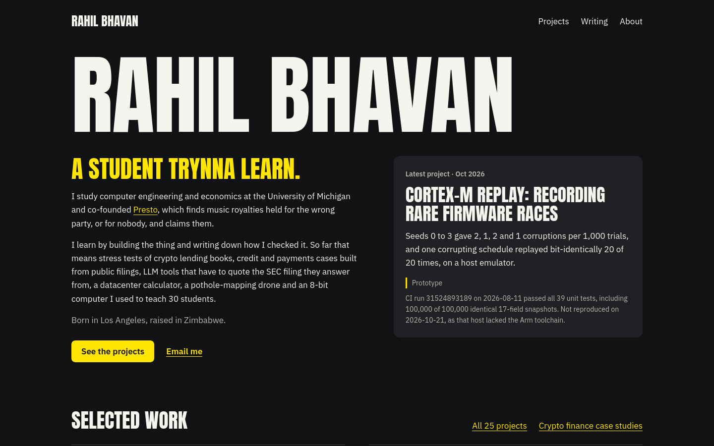

# Personal site: Rahil Bhavan's projects and writing, each with how it was checked

[](https://github.com/RahilBhavan/website/actions/workflows/ci.yml) [](LICENSE)

**Live:** <https://rahilbhavan.com>



This is the source of rahilbhavan.com, a static-first Astro site. It holds 26 project case pages and 28 written posts. Each case page states its result, its status (proposal, prototype or shipped), how it was checked and what comes next.

## What it does

- Lists projects and writing with topic filters, and links each post to its case page and back (`bun run check` fails if a case page does not link back).
- Publishes `/rss.xml`, a sitemap, `public/llms.txt` and a `/work.json` feed of published work.
- Hosts the RISC-V core figures as static pages under `public/riscv/` and an interactive datacenter calculator under `public/tools/datacenter-math/`.
- Generates a social card per project into `public/og/` with `bun run og`.

## How it works

Content is Markdown and MDX in `src/content/projects/` and `src/content/blog/`. `src/content.config.ts` validates the frontmatter (`result`, `status`, `verification`, `next`, `figure`). Routes live in `src/pages/`, shared helpers in `src/lib/content.ts`, and `src/layouts/` and `src/components/` hold the page shell. The site builds with the `@astrojs/vercel` adapter. Fonts (Archivo and IBM Plex Mono, SIL OFL) are self-hosted in `public/fonts/`; Anton and IBM Plex Sans remain for the textbook reader. Visual rules are in [DESIGN.md](DESIGN.md).

## Run it

Prerequisites: [Bun](https://bun.sh) 1.x and Node 24.

```bash
bun install --frozen-lockfile
bun run dev        # http://localhost:4321
bun run check      # type-check, build, link and anchor check, cross-link check, unit tests
bunx playwright install firefox && bun run test:e2e   # smoke test of the built site (run `bun run build` first)
```

`bun run check` ran clean on 2026-10-26: 0 type errors, 82 pages with no broken internal links, 28 post-to-project pairs linked back, 14 unit tests passing. The unit tests cover the datacenter calculator arithmetic and the Spine March 2020 data (`tests/*.test.mjs`). The pages themselves are checked by the two link scripts. `tests/e2e/smoke.spec.mjs` loads 12 key pages in Firefox at 1440 px and 390 px and fails on a non-200 response, a console error, a failed request or horizontal overflow (24 tests, passing on 2026-10-26). CI runs both on every push to `main` and every pull request. Building needs no keys or network.

`bun run preview` does not work with the Vercel adapter. To look at the build, serve `dist/client` with any static file server.

## Repository layout

- `src/`: pages, layouts, components, content and the content helpers
- `public/`: fonts, images, social cards, `llms.txt`, and the static RISC-V and datacenter pages
- `scripts/`: link checks, the static server for the smoke test and the social-card renderer
- `tests/`: Node test runner unit tests and the Playwright smoke test in `tests/e2e/`
- `docs/`: blog plan and archived drafts

## Documentation

- [DESIGN.md](DESIGN.md): the visual system (type, colour, components)
- [docs/blog-plan.md](docs/blog-plan.md): the writing plan and the status of the private networking dashboard
- [docs/archive/](docs/archive/): draft material that is not published

## Scope and limits

- Personal, independent work. Nothing here is affiliated with or endorsed by the companies it discusses.
- Project pages describe other repositories. The numbers on them come from those repositories on the dates the pages give. This repository does not re-run them.
- Case pages marked proposal or prototype are not shipped products. Several counts and live-site figures on project pages are dated snapshots and can drift.
- The smoke test checks that pages load cleanly, not how they look. There is no visual regression test, and layout was checked by eye at 1440 px and 390 px.
- Some external links (LinkedIn, one Zimbabwean news site) block automated requests and were not verifiable by script.

## License

MIT, see [LICENSE](LICENSE). It covers this site's code and writing. The fonts keep their own SIL OFL licenses in `public/fonts/`.

Part of [Rahil Bhavan's projects](https://github.com/RahilBhavan).

## Textbooks

`/textbooks` indexes eleven project textbooks and one shorter Strategy companion. `/books` redirects there. Reading editions are generated before development/build from `src/textbooks/`; generated HTML and vendor assets are ignored. Chart.js, D3 and KaTeX are pinned and copied locally, including their licenses, so readers do not need a CDN. The source books' external evidence links still require internet access.

Run `bun run check` for the normal build/link suite. With the development server on port 4332, run `bun run check:textbooks` for the Firefox behavior checks; `TEXTBOOK_BASE_URL` changes the origin and `FIREFOX_EXECUTABLE` selects an installed Firefox binary. The checks use isolated browser storage. The exact check results and limits are recorded in `docs/textbook-verification/`.
